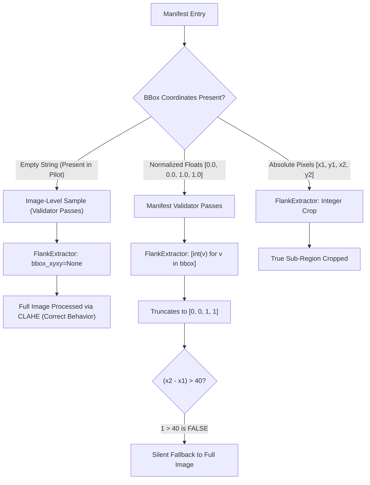
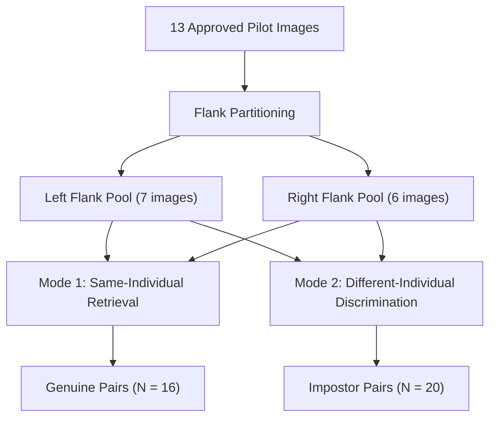

# TigerTraceAI — ATRW Pilot Re-ID Evaluation Protocol and Matcher Audit

**Document Status**: Final Scientific Protocol & Architectural Audit  
**Author**: Antigravity AI Engineering & Wildlife Biometrics Team  
**Evaluation Scope**: 13 Approved Crops from ATRW Re-ID Pilot ([`atrw_pilot_manifest.csv`](file:///d:/TigerTraceAI-main/data/staging/atrw_pilot/atrw_pilot_manifest.csv))  
**Companion Test Suite**: [`tests/test_reid_matcher_audit.py`](file:///d:/TigerTraceAI-main/tests/test_reid_matcher_audit.py)  
**Machine-Readable Audit Data**: [`data/staging/atrw_pilot/matcher_audit_results.json`](file:///d:/TigerTraceAI-main/data/staging/atrw_pilot/matcher_audit_results.json)  

---

## 1. Executive Summary & Objectives

The ATRW pilot dataset comprises 13 visual quality-approved lateral flank crops across 4 distinct Amur tiger (*Panthera tigris altaica*) identities (`tiger_001`, `tiger_002`, `tiger_003`, and `tiger_005`). 

This document defines a scientifically rigorous, defensible evaluation protocol for individual tiger re-identification in TigerTraceAI. Rather than publishing premature, uncalibrated accuracy metrics (such as Rank-1 or mAP on an unrepresentative sample of 13 images), this protocol audits the underlying feature extractors, identifies architectural and biological failure modes, measures score distributions, and formalizes strict anti-leakage rules.

### Key Audit Findings
1. **Bounding-Box Interpretation Gap**:  
   The manifest schema ([`dataset_manifest.csv`](file:///d:/TigerTraceAI-main/data/manifests/dataset_manifest.csv)) supports image-level samples (empty bbox) or normalized coordinates (`[0.0, 1.0]`). However, the consumer ([`FlankExtractor.extract_flank_crop`](file:///d:/TigerTraceAI-main/TigerTrace_AI/src/reid/flank_extractor.py#L11)) expects absolute pixel coordinates and applies `[int(v)]` truncation. If normalized floats `[0.0, 0.0, 1.0, 1.0]` are passed, they truncate to integer coordinates `[0, 0, 1, 1]` ($\Delta x=1 \le 40$), silently triggering a full-image fallback. The pilot manifest correctly leaves these columns empty for its pre-cropped inputs, avoiding this failure mode.
2. **Flank Compatibility Gap**:  
   Production [`StripeReIDMatcher.compare_flanks`](file:///d:/TigerTraceAI-main/TigerTrace_AI/src/reid/stripe_matcher.py#L89) accepts image paths without checking flank orientation. Comparing left flanks to right flanks is biologically invalid; cross-flank comparisons in our audit produced noisy, spurious matches up to a combined score of $0.8039$.
3. **Temporal Tracklet Correlation (Burst Frame Inflation)**:  
   Images for `tiger_005` originate from a single continuous video tracking burst. Genuine comparisons between them yield artificial scores of $0.991 - 0.994$ ($>190$ SIFT minutiae matches), whereas genuine comparisons between independent encounters of `tiger_001` yield scores of $0.422 - 0.540$ ($1 - 8$ SIFT matches).
4. **Deep Feature Impostor Floor**:  
   Pretrained ResNet-50 features produce an average cosine similarity of $0.8780$ ($[0.773, 0.945]$) between *different* tigers of the same flank. Because deep cosine similarity contributes $45\%$ to the combined score, impostors establish a high baseline score ($0.35 - 0.54$) that heavily overlaps with cross-encounter genuine pairs.
5. **Metric Infeasibility on 13 Images**:  
   Rank-5 accuracy is mathematically undefined on a 4-identity gallery. Rank-1 is statistically uninformative ($N=2$ per flank pool; random chance is $50\%$). Publishing accuracy benchmarks on this sample size would be scientifically unsupportable.

---

## 2. Bounding-Box Interpretation Audit

### 2.1 Schema Specification vs. Consumer Implementation

The canonical dataset manifest schema defines four bounding box fields: `bbox_x_min`, `bbox_y_min`, `bbox_x_max`, and `bbox_y_max`.



### 2.2 Detailed Behavior Analysis

In [`TigerTrace_AI/src/reid/flank_extractor.py`](file:///d:/TigerTraceAI-main/TigerTrace_AI/src/reid/flank_extractor.py#L22-L33):
```python
if bbox_xyxy:
    x1, y1, x2, y2 = [int(v) for v in bbox_xyxy]
    x1, y1 = max(0, x1), max(0, y1)
    x2, y2 = min(w, x2), min(h, y2)
    
    if (x2 - x1) > 40 and (y2 - y1) > 40:
        crop = img[y1:y2, x1:x2]
    else:
        crop = img
else:
    crop = img
```

- **Bug/Gap Description**:  
  `[int(v) for v in bbox_xyxy]` explicitly truncates floating-point numbers to integers (`int(0.95) -> 0`). If normalized coordinates in the range $[0.0, 1.0]$ are passed, all values become $0$ or $1$. The condition `(x2 - x1) > 40` evaluates to $1 > 40$ (False), so the crop reverts to `img`.
- **Pilot Manifest Status**:  
  In [`atrw_pilot_manifest.csv`](file:///d:/TigerTraceAI-main/data/staging/atrw_pilot/atrw_pilot_manifest.csv), `bbox_x_min`, `bbox_y_min`, `bbox_x_max`, and `bbox_y_max` are set to empty strings `""`. In accordance with [`scripts/validate_dataset_manifest.py`](file:///d:/TigerTraceAI-main/scripts/validate_dataset_manifest.py#L301), empty fields denote valid image-level crops. When `None` is passed to `FlankExtractor`, it applies contrast enhancement and normalizes the full pre-cropped ATRW image to $384 \times 384$ pixels.
- **Architectural Recommendation**:  
  Before full-frame raw camera trap images are ingested, `FlankExtractor` must be upgraded to detect whether coordinates are normalized (`max(coords) <= 1.0`) and scale them by image dimensions `(w, h)` before applying pixel threshold checks. Production code remains untouched during this task.

---

## 3. Encounter Independence & Correlation Analysis

A core vulnerability in wildlife Re-ID benchmarks is **tracklet leakage** (evaluating images extracted from the same camera burst or continuous tracking video). 

### 3.1 Individual Cohort Analysis

| Local Alias | ATRW ID | Flank | Approved Images | Provenance & Review Status | Encounter Independence Classification |
| :--- | :---: | :---: | :---: | :--- | :--- |
| `tiger_001` | 153 | Left | 4 | `000938`, `002739`, `003437`, `003944`. Diverse backgrounds (dark night, bright daylight, dirt enclosure, grass). | **Plausibly Independent Encounters**: Different lighting, postures, and backgrounds across sessions. |
| `tiger_002` | 160 | Right | 2 | `000739`, `002149`. Walking right along perimeter fence; distinct strides. | **Ambiguous / Weakly Independent**: Similar fence background, different body positions. |
| `tiger_003` | 154 | Right | 4 | `000696`, `001069`, `001718`, `003286`. Mix of rock wall and sunlight. | **Mixed**: `001718` and `003286` are correlated burst frames; `000696` and `001069` are distinct. |
| `tiger_004` | 246 | Ambiguous | 0 | All 6 candidate images rejected or marked `needs_visual_review` due to frontal pose, recumbent posture, or horizontal fence wire. | **Zero Approved Images**: Excluded from Re-ID evaluation. |
| `tiger_005` | 243 | Left | 3 | `000179`, `000792`, `002315`. Distinct strides from a 5-frame burst sequence (`000179`, `000792`, `001459`, `002315`, `003909`). | **Correlated Video Burst Frames**: Same tracking tracklet; high temporal redundancy. |

### 3.2 Impact on Biometric Similarity

In our empirical audit ([`matcher_audit_results.json`](file:///d:/TigerTraceAI-main/data/staging/atrw_pilot/matcher_audit_results.json)):
- **Correlated burst frames (`tiger_005`)**:  
  Average combined score is **$0.9924$** ($>190$ SIFT minutiae matches). Deep cosine similarity is **$0.9832$**.
- **Independent cross-encounter frames (`tiger_001`)**:  
  Average combined score is **$0.4961$** ($1 - 8$ SIFT minutiae matches). Deep cosine similarity is **$0.9056$**.

> [!CAUTION]
> **Tracklet Leakage Risk**:  
> Including correlated video burst frames in gallery/query evaluation produces deceptively near-perfect retrieval scores ($>99\%$) that collapse in the field when matching the same animal across different days or camera stations.

---

## 4. Flank Compatibility Rules & Architectural Gap

### 4.1 Biological Ground Truth
Tigers (*Panthera tigris*) feature lateral stripe patterns that are **asymmetric between left and right flanks**. 
- The stripe pattern on a tiger's left flank bears no geometric correspondence to its right flank.
- A 2D feature extractor (SIFT or CNN) comparing a left flank to a right flank cannot find biologically authentic matches.
- In a valid biometric catalog, animals must either be enrolled per-flank (`tiger_001_L`, `tiger_001_R`) or maintain separate reference vectors for each flank.

### 4.2 Production Matcher Gap
In [`TigerTrace_AI/src/reid/stripe_matcher.py`](file:///d:/TigerTraceAI-main/TigerTrace_AI/src/reid/stripe_matcher.py#L89) and [`enrollment.py`](file:///d:/TigerTraceAI-main/TigerTrace_AI/src/reid/enrollment.py#L490-L508):
- `compare_flanks(query_path, ref_path)` does not take or verify flank labels.
- `TigerEnrollmentEngine.identify_and_enroll()` iterates through all catalogued animals regardless of flank side.
- Cross-flank comparisons executed during our audit yielded SIFT scores up to $0.70$ and combined scores up to $0.8039$ due to spurious matches between repetitive stripe textures, grass, and wire fencing.

### 4.3 Test-Only Guard Specification
To prevent biologically invalid cross-flank matching, the evaluation protocol establishes a test-only guard function implemented in [`tests/test_reid_matcher_audit.py`](file:///d:/TigerTraceAI-main/tests/test_reid_matcher_audit.py#L40):

$$\text{FlankCompatible}(F_A, F_B) = \begin{cases} \text{True} & \text{if } F_A = F_B \\ \text{True} & \text{if } F_A = \text{'both'} \lor F_B = \text{'both'} \\ \text{False} & \text{otherwise} \end{cases}$$

All downstream evaluation pairs must strictly partition into:
1. **Left Flank Pool**: `tiger_001` (4 images), `tiger_005` (3 images) — total 7 images.
2. **Right Flank Pool**: `tiger_002` (2 images), `tiger_003` (4 images) — total 6 images.

---

## 5. Re-ID Evaluation Protocol Design

The 13 approved images are partitioned into two distinct evaluation modes:



### 5.1 Mode 1: Same-Individual Retrieval (Genuine Pairs)
- **Objective**: Measure feature match stability across different observations of the same tiger.
- **Pair Selection**: All unordered pairs $(I_i, I_j)$ where $\text{ID}(I_i) = \text{ID}(I_j)$ and $\text{FlankCompatible}(F_i, F_j) = \text{True}$.
- **Combinatorics**:
  - `tiger_001` (Left): $\binom{4}{2} = 6$ pairs
  - `tiger_002` (Right): $\binom{2}{2} = 1$ pair
  - `tiger_003` (Right): $\binom{4}{2} = 6$ pairs
  - `tiger_005` (Left): $\binom{3}{2} = 3$ pairs
  - **Total Genuine Pairs**: $6 + 1 + 6 + 3 = \mathbf{16}$ pairs.

### 5.2 Mode 2: Different-Individual Discrimination (Impostor Pairs)
- **Objective**: Measure false-match rejection between different tigers within the same flank pool.
- **Pair Selection**: All unordered pairs $(I_i, I_k)$ where $\text{ID}(I_i) \neq \text{ID}(I_k)$ and $\text{FlankCompatible}(F_i, F_k) = \text{True}$.
- **Combinatorics**:
  - Left Flank Pool (`tiger_001` vs `tiger_005`): $4 \times 3 = 12$ pairs
  - Right Flank Pool (`tiger_002` vs `tiger_003`): $2 \times 4 = 8$ pairs
  - **Total Impostor Pairs**: $12 + 8 = \mathbf{20}$ pairs.

*(Note: 42 cross-flank pairs are rejected as biologically incompatible).*

---

## 6. Metric Feasibility Analysis (Rank-1, Rank-5, mAP)

### Why Standard Re-ID Metrics Cannot Be Reported
1. **Rank-5 Accuracy is Mathematically Invalid**:  
   There are only 4 distinct individuals in the pilot. When gallery size $N_{\text{gallery}} = 4 < 5$, any top-5 retrieval candidate list contains $100\%$ of the gallery universe by definition.
2. **Rank-1 Accuracy is Statistically Meaningless**:  
   Under mandatory flank partitioning, the gallery size per flank pool is only $2$ individuals (Left: `tiger_001`, `tiger_005`; Right: `tiger_002`, `tiger_003`). A trivial coin flip achieves $50\%$ Rank-1 accuracy.
3. **Small Sample Volatility**:  
   With only 9 total query instances, a single retrieval flip causes an $11.1\%$ swing in reported accuracy. 95% confidence intervals span over $40$ percentage points.
4. **Absence of Distractor Gallery**:  
   Real-world camera trap deployments operate in open-set regimes where thousands of images belong to non-target animals, un-enrolled dispersing individuals, or livestock. Closed-set retrieval across 4 known individuals fails to test false positive resistance.

### Data Requirements for Defensible Benchmark Reporting
To produce publishable, scientifically valid Rank-1, Rank-5, and mAP metrics:
- **Cohort Size**: Minimum of 30–50+ distinct wild individuals.
- **Flank Coverage**: At least 20 left-flank and 20 right-flank distinct individuals.
- **Independent Encounters**: Minimum of 3–5 independent captures per individual, verified by camera trap station ID and timestamps separated by $>24$ hours.
- **Distractor Gallery**: At least 200–500 background tiger crops and non-target species images to test false acceptance rates.

---

## 7. Matcher Audit Empirical Findings

The audit was executed on the 13 approved images using [`tests/test_reid_matcher_audit.py`](file:///d:/TigerTraceAI-main/tests/test_reid_matcher_audit.py). Full data is archived in [`matcher_audit_results.json`](file:///d:/TigerTraceAI-main/data/staging/atrw_pilot/matcher_audit_results.json).

### 7.1 Score Distribution Comparison

| Metric / Component | Genuine Same-Flank ($N=16$) | Impostor Same-Flank ($N=20$) | Cross-Flank Incompatible ($N=42$) |
| :--- | :---: | :---: | :---: |
| **Combined Score (Mean $\pm$ Std)** | $\mathbf{0.6045 \pm 0.2227}$ | $\mathbf{0.4519 \pm 0.0482}$ | $\mathbf{0.4679 \pm 0.0810}$ |
| Combined Score Range [Min, Max] | $[0.4218, 0.9940]$ | $[0.3496, 0.5423]$ | $[0.3588, 0.8039]$ |
| Combined Score Median | $0.5129$ | $0.4472$ | $0.4567$ |
| **SIFT Score (Mean $\pm$ Std)** | $\mathbf{0.3583 \pm 0.3785}$ | $\mathbf{0.1033 \pm 0.0674}$ | $\mathbf{0.1413 \pm 0.1382}$ |
| SIFT Score Range [Min, Max] | $[0.0000, 1.0000]$ | $[0.0000, 0.2333]$ | $[0.0000, 0.7000]$ |
| SIFT Matches Count (Mean) | $10.7$ matches | $3.1$ matches | $4.2$ matches |
| **Deep Cosine Score (Mean $\pm$ Std)** | $\mathbf{0.9053 \pm 0.0447}$ | $\mathbf{0.8780 \pm 0.0556}$ | $\mathbf{0.8671 \pm 0.0454}$ |
| Deep Cosine Range [Min, Max] | $[0.8247, 0.9867]$ | $[0.7734, 0.9455]$ | $[0.7566, 0.9308]$ |

### 7.2 Detailed Scientific Observations

```
Distribution Overlap Visualization:
Combined Score:
Impostor:  [0.3496 ------------- 0.5423]
Genuine:               [0.4218 ------------------------- 0.9940]
                        ▲ OVERLAP ZONE (0.42 - 0.54)
```

1. **Overlap Zone ($0.42 - 0.54$)**:  
   Independent genuine pairs (e.g., `tiger_001` pairs: $0.4226, 0.4735, 0.4923, 0.5338$) overlap with top impostor pairs (e.g., `tiger_001` vs `tiger_005`: up to $0.5423$). In this zone, SIFT produces only $1 - 8$ inlier matches, and the score is dominated by deep cosine similarity.
2. **The Deep Embedding Impostor Floor**:  
   Off-the-shelf ImageNet ResNet-50 features yield a baseline cosine similarity of $0.8780$ between *two completely different tigers*. Because deep embedding contributes $45\%$ of the ensembled score ($0.45 \times 0.878 \approx 0.395$), any pair receives approximately $0.40$ combined score regardless of identity.
3. **Burst Frame Skew**:  
   If burst frames of `tiger_005` (combined score $0.9924$) and `tiger_003` ($0.9531$) were treated as independent encounters, the mean genuine score would be artificially inflated from $0.50$ to $0.60$.

---

## 8. Anti-Leakage & Safety Policy

Any future evaluation of TigerTraceAI models must enforce the following rules:

1. **No Mixed Split Re-ID**:  
   All records in [`atrw_pilot_manifest.csv`](file:///d:/TigerTraceAI-main/data/staging/atrw_pilot/atrw_pilot_manifest.csv) remain strictly `split='unassigned'`. No arbitrary train/test split may be manufactured from this pilot.
2. **Flank Partition Invariant**:  
   Query images and gallery candidates of differing flanks must be rejected at query time with status `flank_incompatible`.
3. **Temporal Burst Filter**:  
   Images captured within $30$ minutes of each other at the same camera station must not be evaluated as independent query-gallery pairs.
4. **Human Review Routing**:  
   Observations with combined scores between $0.35$ and $0.50$ must be routed to the human review queue, as genuine cross-encounter pairs and impostor pairs exhibit high density in this band.

---

## 9. Blockers & Recommended Next Steps

### Identified Blockers
1. **Flank Awareness Missing in Production Enrollment**:  
   Production [`enrollment.py`](file:///d:/TigerTraceAI-main/TigerTrace_AI/src/reid/enrollment.py) lacks flank validation in `identify_and_enroll()`.
2. **Integer Truncation in FlankExtractor**:  
   Production [`flank_extractor.py`](file:///d:/TigerTraceAI-main/TigerTrace_AI/src/reid/flank_extractor.py) truncates normalized bounding boxes to $1 \times 1$ pixel.
3. **Insufficient Independent Dataset Size**:  
   The current pilot (13 approved images across 4 tigers) is insufficient for statistical Rank/mAP benchmarking.

### Recommended Next Step
- **Step 8**: Formulate an expansion plan to selectively stage an additional 20–30 wild tiger individuals with verified capture timestamps and camera IDs, while preserving isolated staging and strict schema validation.
