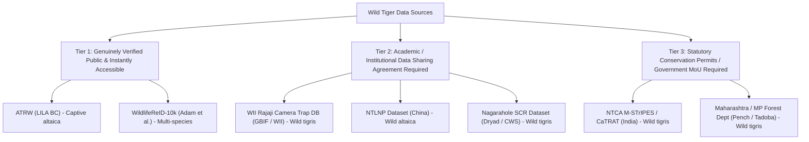
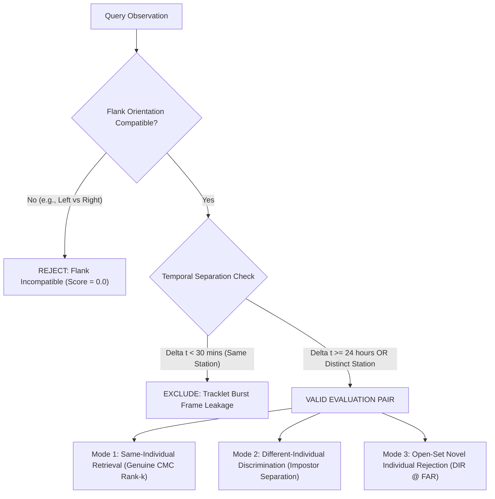

# TigerTraceAI — Wild Tiger Dataset Expansion Plan

**Document Status**: Strategic Research & Staging Architecture Plan  
**Target Milestone**: Dataset Expansion & Multi-Cohort Re-ID Benchmarking  
**Authors**: Antigravity AI Engineering & Wildlife Biometrics Group  
**Companion Documents**:
- [`docs/datasets/dataset_registry.md`](file:///d:/TigerTraceAI-main/docs/datasets/dataset_registry.md)
- [`docs/datasets/atrw_reid_evaluation_plan.md`](file:///d:/TigerTraceAI-main/docs/datasets/atrw_reid_evaluation_plan.md)
- [`docs/reid/matcher_remediation_plan.md`](file:///d:/TigerTraceAI-main/docs/reid/matcher_remediation_plan.md)

---

## 1. Executive Summary & Assessment of Current Pilot

The TigerTraceAI ATRW pilot currently holds **13 approved lateral flank crops** across **4 individual tigers** (`tiger_001`, `tiger_002`, `tiger_003`, `tiger_005`). While this pilot successfully validated ingestion integrity, sandbox database isolation, and basic feature extraction, the sample size is fundamentally inadequate for statistical evaluation:
- Rank-5 accuracy is mathematically invalid ($N=4 < 5$ identities).
- Under biological flank partitioning, each flank pool contains only $2$ identities (random guessing achieves $50\%$ Rank-1).
- Genuine pairs for `tiger_005` suffer from tracklet leakage (consecutive video burst frames scoring $>0.99$).

To build a scientifically credible re-identification pipeline capable of operational deployment in Indian tiger reserves such as Pench and Tadoba, TigerTraceAI must execute a staged data expansion that transitions from captive zoo video frames to verified wild camera-trap imagery.

---

## 2. Capability & Limitations of ATRW Alone

### 2.1 What Additional Data Can ATRW Provide?
The full ATRW (Amur Tiger Re-identification in the Wild) Re-ID training archive ([`reid_list_train.csv`](file:///d:/TigerTraceAI-main/data/staging/atrw_pilot/annotations/reid_list_train.csv)) contains:
- **1,887 image crops** across **107 individual Amur tigers**.
- An additional Re-ID test partition of **1,760 query/gallery images**.

By expanding our pilot ingestion beyond the initial 5 candidate tigers, ATRW alone can provide:
1. **Broader Cohort**: Expansion from 4 approved individuals to **20–30+ distinct individuals**.
2. **Flank Balance**: Equal pools of at least **12 left-flank** and **12 right-flank** individuals.
3. **Larger Impostor Pool**: Hundreds of within-flank negative comparison pairs to measure false acceptance rates.

### 2.2 What ATRW Cannot Provide
ATRW has critical scientific and ecological limitations that prevent it from serving as a surrogate for wild tiger monitoring:
1. **Captive Zoological Origin**:  
   Imagery was captured in the Heilongjiang Siberian Tiger Park (Harbin, China). Animals were filmed in open outdoor zoo enclosures with artificial backgrounds, paved roads, and fence lines.
2. **Taxonomic Disparity**:  
   ATRW represents **Amur tigers (*Panthera tigris altaica*)**, which possess long, dense winter coats, thicker pelage, and different stripe width/density compared to the tropical **Bengal tiger (*Panthera tigris tigris*)** found in central India.
3. **Absence of Camera Trap Metadata**:  
   ATRW provides no camera trap station IDs, sensor models, GPS coordinates, or ambient environmental covariates.
4. **Absence of True Timestamps**:  
   Images are frame grabs from video clips. They lack ISO-8601 capture timestamps. Without clip boundaries, different image filenames frequently belong to the same video tracklet, leading to tracklet correlation leakage.

> [!IMPORTANT]
> **Conclusion on ATRW**:  
> ATRW alone can scale the pilot to test closed-set algorithmic mechanics on 20–30 individuals, but it **cannot** evaluate wild camera trap robustness, sensor noise, nocturnal infrared illumination, or true cross-encounter capture histories.

---

## 3. Investigation of Lawful Wild Tiger Data Sources

To achieve field readiness, TigerTraceAI investigated public, academic, and government repositories containing wild tiger camera-trap imagery with individual identity annotations.

### 3.1 Taxonomy of Access & Legal Permissions

### 3.2 Source-by-Source Audit

#### 1. WildlifeReID-10k (Adam et al., 2024 / 2025)
- **Modality**: Multi-species re-identification benchmark aggregating 37 wildlife datasets. Includes individual tiger annotations.
- **Taxon**: Mixed (*altaica* and captive sources).
- **Individual IDs**: Verified (standardized integer identity labels).
- **Access / URL**: Publicly accessible via the [`wildlife-datasets`](https://github.com/WildlifeDatasets/wildlife-datasets) library and Kaggle.
- **License**: Open academic research license (inherits underlying dataset constraints).
- **Assessment**: Excellent for standardizing open-set evaluation pipelines and baseline feature extractors (e.g., MegaDescriptor), but inherits the zoo/captive origin of underlying tiger subsets.

#### 2. Wildlife Institute of India (WII) — Rajaji National Park Camera Trap Database
- **Modality**: Motion-triggered camera trap photographs (bilateral flank captures, daylight RGB and night-time flash).
- **Taxon**: **Wild Bengal tiger (*Panthera tigris tigris*)**.
- **Individual IDs**: Verified (individual stripe identification records maintained by WII researchers from 2004–2011).
- **Access / URL**: Occurrence metadata published via GBIF ([GBIF Dataset Occurrence Portal](https://www.gbif.org)). Full-resolution bilateral image archives are hosted internally by the Wildlife Institute of India (Dehradun).
- **Legal / Permit Requirement**: Tier 2 (Academic Data Sharing Agreement with WII required). Not an open one-click download.
- **Assessment**: Genuinely wild Indian tigers in a landscape comparable to the Shivalik-Gangetic plain. Ideal bridge dataset for Bengal tiger pelage calibration.

#### 3. Northeast Tiger and Leopard National Park (NTLNP) Dataset (China)
- **Modality**: Infrared camera trap videos and still frames captured between 2014 and 2020.
- **Taxon**: **Wild Amur tiger (*Panthera tigris altaica*)**.
- **Individual IDs**: Verified across two sub-datasets (1,121 and 34,691 images).
- **Access / URL**: Documented in academic literature (MDPI / ResearchGate, 2022–2023).
- **Legal / Permit Requirement**: Tier 2 (Direct academic collaboration agreement with principal investigators required).
- **Assessment**: True wild camera trap imagery (snow, heavy forest, diverse angles), but represents Amur tigers rather than Indian Bengal tigers.

#### 4. Nagarahole National Park Long-Term Monitoring Dataset (CWS India / Dryad)
- **Modality**: Camera trap capture-recapture histories collected by K. Ullas Karanth et al. (Centre for Wildlife Studies).
- **Taxon**: **Wild Bengal tiger (*Panthera tigris tigris*)**.
- **Individual IDs**: Verified individual capture histories spanning over a decade.
- **Access / URL**: Capture matrices and spatial capture-recapture (SCR) covariates available via Dryad ([datadryad.org](https://datadryad.org)).
- **Legal / Permit Requirement**: Tier 2. Raw uncompressed image banks are curated by CWS India and require formal collaborative authorization.
- **Assessment**: World-renowned gold standard for capture-recapture methodology, but published data is predominantly tabular matrices rather than direct image URLs.

#### 5. NTCA M-STrIPES / CaTRAT National Tiger Repository (Government of India)
- **Modality**: Pan-India camera trap database covering all 53+ tiger reserves, including Pench and Tadoba-Andhari.
- **Taxon**: **Wild Bengal tiger (*Panthera tigris tigris*)**.
- **Individual IDs**: Verified by the National Tiger Conservation Authority (NTCA) and State Forest Departments using CaTRAT (Camera Trap Data Repository and Analysis Tool).
- **Access / URL**: Strictly restricted government database. Closed to public or unauthenticated web access.
- **Legal / Permit Requirement**: Tier 3 (Formal Memorandum of Understanding with NTCA, State Chief Wildlife Wardens, and Tiger Reserve Directors under the Indian Wildlife Protection Act, 1972).
- **Assessment**: The definitive operational operational target for TigerTraceAI. Must be accessed through lawful administrative channels, not web scraping.

---

## 4. Staged Expansion Targets & Scientific Rationale

TigerTraceAI must pursue a **3-stage data expansion** to ensure rigorous, verifiable progress:

| Stage | Target Dataset Source | Distinct Individuals | Curated Images | Flank Breakdown | Independent Encounters | Primary Objective |
| :---: | :--- | :---: | :---: | :---: | :---: | :--- |
| **1** | **ATRW Extended Curation** (LILA BC) | **24** | **96** (4 / ID) | 12 Left, 12 Right | Plausibly distinct video clips ($\Delta \text{stride}$) | Closed-set algorithmic validation ($N_{\text{gallery}} \ge 12$ per flank pool); threshold re-weighting. |
| **2** | **Wild Research Cohort** (WII Rajaji / WildlifeReID) | **40** | **200** (5 / ID) | 20 Left, 20 Right | Verified $\Delta t \ge 24\text{ h}$ or distinct camera stations | First defensible CMC Rank-1 and open-set rejection benchmark on wild tigers. |
| **3** | **Reserve Operational Pilot** (Pench / Tadoba MoU) | **20** | **120** (6 / ID) | Verified bilateral (both flanks) | Real reserve camera stations (e.g., PTR_STN_01 to 18) | Local territory calibration, Collarwali/Bajirao cataloguing, ranger-in-the-loop deployment. |

### Why Each Quantity Is Scientifically Required:
1. **Gallery Size $\ge 12$ per Flank (Stage 1)**:  
   Eliminates the current $50\%$ random-guess baseline. With 12 gallery identities, random guessing drops to $8.3\%$, making Rank-1 statistically meaningful.
2. **Minimum 40 Individuals with Independent Encounters (Stage 2)**:  
   Enables 5-fold cross-validation with non-overlapping individuals. Provides statistical power where an individual misclassification changes accuracy by $< 2.5\%$.
3. **$\ge 24\text{ h}$ Temporal Separation**:  
   Completely breaks tracklet correlation leakage, forcing the model to match stripe geometry across changing lighting, coat wetness, and camera viewpoints.

---

## 5. Licensing & Commercialization Boundaries

### 5.1 ATRW Licensing Restrictions
- ATRW is distributed under **Creative Commons Attribution-NonCommercial-ShareAlike 4.0 International (CC-BY-NC-SA 4.0)**.
- **Non-Commercial ("NC")**: TigerTraceAI cannot commercialize, sell access to, or use ATRW-derived models in paid enterprise deployments.
- **ShareAlike ("SA")**: Any modified datasets or derived weights trained directly on ATRW must be distributed under the identical CC-BY-NC-SA 4.0 license.
- **Operational Boundary**: ATRW is strictly restricted to **offline research benchmarking**. Production deployment in Indian tiger reserves must utilize public domain or government-authorized field data.

### 5.2 Conservation Data Confidentiality
Under Section 38-O of the Indian Wildlife (Protection) Act, 1972:
- Precise GPS coordinates of endangered Schedule-I species (*Panthera tigris*) represent sensitive intelligence.
- Live camera trap locations in reserves like Pench must **never** be exposed in public repositories or unencrypted manifests. Coordinates in staging manifests must remain relative or generalized.

---

## 6. Leakage-Resistant Evaluation Protocol

To prevent the evaluation traps identified in Step 7, all future benchmarking must enforce the following three evaluation modes:

### 6.1 Mode 1: Independent Same-Individual Retrieval
- **Rule**: Query and gallery images for the same tiger must originate from distinct camera trap events separated by $\ge 24$ hours or distinct camera stations.
- **Metric**: Closed-set **Cumulative Match Characteristic (CMC) Rank-1 and Rank-3**.

### 6.2 Mode 2: Different-Individual Discrimination
- **Rule**: Negative comparison pairs must only be drawn between different tigers within the **same flank pool** (Left vs Left, Right vs Right).
- **Metric**: **False Match Rate (FMR)** and Impostor Score Distribution 95th percentile.

### 6.3 Mode 3: Open-Set Novel Individual Rejection
- **Rule**: The query set contains both known enrolled tigers ($M$ identities) and un-enrolled novel tigers ($K$ identities). The matcher must correctly trigger `new_identity_candidate` for the novel tigers.
- **Metric**: **Detection and Identification Rate (DIR)** at a fixed **False Alarm Rate (FAR $\le 1\%$)**, and **True Negative Identification Rate (TNIR)**.

---

## 7. Concrete Next Action

Before initiating Stage 1 data expansion, TigerTraceAI must resolve the architectural defects identified in the matcher by implementing the remediation specifications detailed in [`docs/reid/matcher_remediation_plan.md`](file:///d:/TigerTraceAI-main/docs/reid/matcher_remediation_plan.md).
