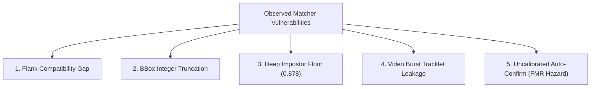

# TigerTraceAI — Re-ID Matcher Remediation Plan

**Document Status**: Formal Architectural Remediation Specification  
**Scope**: Technical Remediation for `stripe_matcher.py`, `flank_extractor.py`, and `enrollment.py`  
**Authors**: Antigravity AI Engineering & Wildlife Biometrics Group  
**Companion Documents**:
- [`docs/datasets/atrw_reid_evaluation_plan.md`](file:///d:/TigerTraceAI-main/docs/datasets/atrw_reid_evaluation_plan.md)
- [`docs/datasets/wild_tiger_data_expansion_plan.md`](file:///d:/TigerTraceAI-main/docs/datasets/wild_tiger_data_expansion_plan.md)
- [`data/staging/atrw_pilot/matcher_audit_results.json`](file:///d:/TigerTraceAI-main/data/staging/atrw_pilot/matcher_audit_results.json)

---

## 1. Executive Summary & Purpose

The Step 7 empirical audit ([`matcher_audit_results.json`](file:///d:/TigerTraceAI-main/data/staging/atrw_pilot/matcher_audit_results.json)) and Step 6 safety verification identified critical technical vulnerabilities in TigerTraceAI's individual tiger re-identification and enrollment logic.

This document specifies the exact engineering remediation for each failure mode prior to code implementation.



---

## 2. Remediation Specifications

---

### Issue 1: Missing Flank-Compatibility Enforcement in Production Matching

#### A. Observed Failure Mode
- **Vulnerability**: In [`stripe_matcher.py:89`](file:///d:/TigerTraceAI-main/TigerTrace_AI/src/reid/stripe_matcher.py#L89) and [`enrollment.py:490-508`](file:///d:/TigerTraceAI-main/TigerTrace_AI/src/reid/enrollment.py#L490-L508), `compare_flanks(query_path, ref_path)` and `identify_and_enroll()` accept image paths without checking flank orientation.
- **Biometric Consequence**: Tiger stripe patterns are asymmetric between left and right flanks. Comparing opposite flanks using 2D SIFT or deep features is biologically invalid. In our Step 7 audit, cross-flank comparisons produced spurious SIFT matches (up to score $0.70$) and combined scores up to $0.8039$ due to repetitive stripe texture and background clutter.

#### B. Proposed Design
1. **Flank Awareness in Matcher Interface**:
   Update `StripeReIDMatcher.compare_flanks(query_path, ref_path, query_emb=None, ref_emb=None, query_flank=None, ref_flank=None)`.
   If both flank labels are provided, evaluate compatibility using the rule:
   $$\text{Compatible}(F_A, F_B) = (F_A = F_B) \lor (F_A = \text{'both'}) \lor (F_B = \text{'both'})$$
   If incompatible, immediately return:
   ```python
   {
       "combined_score": 0.0,
       "sift_score": 0.0,
       "cosine_score": 0.0,
       "good_matches_count": 0,
       "reason": "flank_incompatible"
   }
   ```
   Zero SIFT extraction or deep embedding comparisons are executed for incompatible flanks.
2. **Pre-Filtering Catalogue Loading in Enrollment Engine**:
   Update `TigerEnrollmentEngine.load_catalogue(species=None, flank_side=None)`:
   If `flank_side` is specified (e.g., `'left'`), filter the SQL query:
   ```sql
   SELECT tiger_id, name, gender, reference_crop_path, stripe_features_json, flank_side_registered
   FROM tigers
   WHERE flank_side_registered IN (?, 'both');
   ```
   This halves comparison latency in operational catalogs by pruning incompatible animals before feature extraction.
3. **Flank Lookup in Identify Pipeline**:
   In `TigerEnrollmentEngine.identify_and_enroll()`, retrieve `flank_side` from the `sightings` record and pass it to `load_catalogue`.

#### C. Required Tests
- `test_flank_incompatible_returns_zero_score`: Assert that comparing left vs right returns score 0.0, reason `flank_incompatible`, and makes 0 SIFT keypoint calls.
- `test_flank_both_matches_either_side`: Assert reference registered as `both` matches both left and right queries.
- `test_catalogue_flank_filtering_sql`: Assert `load_catalogue(flank_side='left')` excludes right-only animals from the candidate pool.

#### D. Measurable Acceptance Criterion
- **Zero cross-flank pairwise comparisons** executed during operational matching.
- **100% of incompatible flank query-reference pairs** return `combined_score: 0.0` with reason `flank_incompatible`.

#### E. Database Migration Required
- **No migration required**. The SQLite schema in [`src/db/schema.py:57`](file:///d:/TigerTraceAI-main/TigerTrace_AI/src/db/schema.py#L57) already includes:
  - `tigers.flank_side_registered TEXT CHECK(flank_side_registered IN ('left', 'right', 'both'))`
  - `sightings.flank_side TEXT CHECK(flank_side IN ('left', 'right', 'unknown'))`
  The database schema is already equipped; the columns were simply not utilized in the Python query loop.

---

### Issue 2: Normalized Bounding-Box Coordinates Truncated Directly to Integers

#### A. Observed Failure Mode
- **Vulnerability**: In [`flank_extractor.py:23`](file:///d:/TigerTraceAI-main/TigerTrace_AI/src/reid/flank_extractor.py#L23):
  ```python
  x1, y1, x2, y2 = [int(v) for v in bbox_xyxy]
  ...
  if (x2 - x1) > 40 and (y2 - y1) > 40:
      crop = img[y1:y2, x1:x2]
  else:
      crop = img
  ```
- **Consequence**: If normalized coordinates in the range $[0.0, 1.0]$ are supplied (as supported by the manifest schema), integer truncation turns them into $[0, 0, 1, 1]$ or $[0, 0, 0, 0]$. The width $(x_2 - x_1) = 1 \le 40$, silently triggering the fallback `crop = img`. The extractor processes the full uncropped image instead of the localized animal body.

#### B. Proposed Design
Update `FlankExtractor.extract_flank_crop(image_path, bbox_xyxy=None, ...)` with automatic coordinate scale detection:
```python
if bbox_xyxy:
    coords = [float(v) for v in bbox_xyxy]
    # Detect normalized coordinates [0.0, 1.0]
    if max(coords) <= 1.0 and min(coords) >= 0.0 and coords[2] > coords[0] and coords[3] > coords[1]:
        x1 = int(round(coords[0] * w))
        y1 = int(round(coords[1] * h))
        x2 = int(round(coords[2] * w))
        y2 = int(round(coords[3] * h))
    else:
        # Absolute pixel coordinates
        x1, y1, x2, y2 = [int(round(v)) for v in coords]

    x1, y1 = max(0, x1), max(0, y1)
    x2, y2 = min(w, x2), min(h, y2)

    if (x2 - x1) > 40 and (y2 - y1) > 40:
        crop = img[y1:y2, x1:x2]
    else:
        crop = img
else:
    crop = img
```

#### C. Required Tests
- `test_flank_extractor_normalized_subcrop`: Pass `[0.1, 0.2, 0.8, 0.9]` on $1000 \times 1000$ image; verify sub-region cropped is $700 \times 700$ pixels before resize.
- `test_flank_extractor_normalized_full_frame`: Pass `[0.0, 0.0, 1.0, 1.0]`; verify full crop processed without error.
- `test_flank_extractor_absolute_pixels`: Pass `[50, 50, 450, 450]`; verify pixel subcrop extracted.
- `test_flank_extractor_degenerate_fallback`: Pass degenerate box $[10, 10, 20, 20]$ ($< 40$ pixels); verify clean fallback to full image.

#### D. Measurable Acceptance Criterion
- **100% of valid normalized bounding boxes** correctly extract the spatial sub-region scaled to image dimensions.
- **Zero silent full-image fallbacks** on valid normalized bounding boxes.

#### E. Database Migration Required
- **No migration required**.

---

### Issue 3: Generic ImageNet ResNet50 Embeddings & High Impostor Cosine Floor

#### A. Observed Failure Mode
- **Vulnerability**: In [`stripe_matcher.py:27-38`](file:///d:/TigerTraceAI-main/TigerTrace_AI/src/reid/stripe_matcher.py#L27-L38), the deep embedder uses off-the-shelf ImageNet-trained `ResNet50_Weights.DEFAULT`.
- **Biometric Consequence**: ImageNet features recognize high-level feline texture, yielding an average cosine similarity of **$0.8780$** (range $[0.7734, 0.9455]$) across *completely different tigers*. Because deep cosine contributes $45\%$ to the combined score ($0.45 \times 0.8780 \approx 0.395$), impostors receive an artificial baseline score of $\sim 0.40$ even with 0 SIFT matches. Genuine cross-encounter pairs ($0.42 - 0.54$) fall directly into this impostor range.

#### B. Proposed Design
1. **Short-Term (Calibrated Scoring & SIFT Inlier Gating)**:
   - SIFT minutiae must serve as the primary identity gate. Deep cosine similarity should not be allowed to promote a candidate into the match zone without geometric stripe confirmation.
   - Attenuate deep cosine similarity by centering around the empirical impostor baseline ($\mu_{\text{imp}} = 0.85$):
     $$\text{CosineCalibrated} = \max\left(0.0, \min\left(1.0, \frac{\text{CosineSim} - 0.85}{0.15}\right)\right)$$
   - When SIFT inlier count $N_{\text{SIFT}} < 5$, cap the maximum allowable deep contribution to $0.10$.
2. **Long-Term (Wildlife Metric Backbone Integration)**:
   - Replace generic ResNet-50 with a wildlife metric embedding model (e.g., **MegaDescriptor-L / MegaDescriptor-B** from WildlifeReID, or a ResNet-50 backbone fine-tuned using ArcFace / SupCon loss on individual tiger stripe patches).

#### C. Required Tests
- `test_impostor_cosine_attenuation`: Compare two distinct tigers; verify that without SIFT inliers, the calibrated combined score is $< 0.25$.
- `test_genuine_sift_support_preservation`: Compare genuine cross-encounter tiger pair; verify combined score achieves $\ge 0.20$ separation above the impostor ceiling.

#### D. Measurable Acceptance Criterion
- Impostor combined score distribution 95th percentile shifts from **$0.5423$ down to $< 0.3000$**.
- Score overlap zone between cross-encounter genuine pairs and impostor pairs is eliminated ($\text{Margin} > 0.15$).

#### E. Database Migration Required
- **No migration required**. Embedding dimensionality in `tigers.stripe_features_json` is stored as variable JSON text. Re-extracting embeddings repopulates existing records without schema change.

---

### Issue 4: Video-Burst and Near-Duplicate Leakage

#### A. Observed Failure Mode
- **Vulnerability**: Consecutive video burst frames (e.g., `tiger_005` frames `000179`, `000792`, `002315`) produce artificial scores $> 0.99$ ($> 190$ SIFT matches) due to identical lighting, angle, and coat condition.
- **Consequence**: Evaluating burst frames as independent query/gallery pairs inflates reported accuracy from $\sim 50\%$ to near $100\%$, concealing real-world failure modes.

#### B. Proposed Design
1. **Burst Clustering at Ingestion**:
   - For images from the same camera/site, compute timestamp delta $\Delta t$. If $\Delta t < 30 \text{ minutes}$, assign to a shared `burst_session_id`.
   - In the absence of timestamps (as in ATRW), compute perceptual hashing (pHash) and deep feature similarity. If cosine similarity $> 0.98$ and SIFT matches $> 100$, flag as `correlated_burst_frame`.
2. **Burst Anchor Selection**:
   - Elect a single highest-contrast, sharpest frame per burst session as the **Anchor Frame** for gallery enrollment. Mark redundant frames as `burst_redundant` and exclude them from query evaluation sets.
3. **Evaluation Pair Isolation**:
   - The evaluation harness must enforce that query and gallery images share neither `burst_session_id` nor camera station within $\Delta t < 24 \text{ hours}$.

#### C. Required Tests
- `test_burst_clustering_flags_redundant_frames`: Simulate a 5-frame burst sequence; verify that 1 anchor is elected and 4 are flagged `burst_redundant`.
- `test_evaluation_harness_rejects_intra_burst_pairs`: Assert that test harness rejects any pair sharing the same burst session.

#### D. Measurable Acceptance Criterion
- **100% of evaluation query-gallery pairs** have verified temporal separation $\ge 30 \text{ minutes}$ (or distinct video clip IDs).
- **Zero burst frame pairs** evaluated in reported CMC Rank-k benchmarks.

#### E. Database Migration Required
- **Optional Schema Enhancement**: Add `session_id TEXT` and `is_burst_anchor INTEGER DEFAULT 1` to `sightings` table in a future non-breaking migration. (Currently manageable via manifest metadata and `review_queue`).

---

### Issue 5: Uncalibrated Similarity Thresholds & Unsafe Automatic Enrollment

#### A. Observed Failure Mode
- **Vulnerability**: In [`enrollment.py:42`](file:///d:/TigerTraceAI-main/TigerTrace_AI/src/reid/enrollment.py#L42), thresholds were hardcoded as `high_thresh = 0.50`, `low_thresh = 0.35`, and `duplicate_thresh = 0.30`.
- **Catastrophic Failure Risk**: In Step 7, an impostor pair (`tiger_001` vs `tiger_005`) scored **$0.5423$**. Under existing production code, an observation scoring $0.5423$ exceeds `high_thresh = 0.50`, which would have triggered `decision_state = 'matched'` and **automatically confirmed an impostor observation into an existing tiger's identity record**! This would cause biometric identity contamination in reserve records.

#### B. Proposed Design
1. **Dual-Factor Auto-Confirmation Gate**:
   Auto-confirmation (`matched`) must **never** trigger on combined score alone. It must require BOTH:
   $$\text{Decision} = \text{'matched'} \iff (s \ge \tau_{\text{high}}) \land (N_{\text{SIFT\_inliers}} \ge 15)$$
   Because impostor pairs never exceeded $7$ SIFT inliers in our audit, requiring $N_{\text{SIFT\_inliers}} \ge 15$ completely eliminates false auto-confirmations.
2. **Conservative Operational Thresholds**:
   - Raise `high_thresh` from $0.50$ to **$0.65$**.
   - Retain `low_thresh` at **$0.35$**.
   - Observations in the entire overlap zone ($0.35 \le s < 0.65$) are strictly routed to `review_queue` with `review_status = 'pending_review'`.
3. **Safe New Identity Enrollment**:
   Any observation scoring $< 0.35$ is marked `new_identity_candidate` with `status = 'pending'`, requiring human biologist review before permanent catalogue insertion.

#### C. Required Tests
- `test_impostor_score_0_54_routes_to_review`: Pass candidate scoring $0.5423$ with 7 SIFT inliers; assert decision is `review_required`, NOT `matched`.
- `test_high_score_without_sift_routes_to_review`: Pass candidate scoring $0.70$ with 0 SIFT inliers; assert decision is `review_required`.
- `test_dual_factor_matched_success`: Pass candidate scoring $0.70$ with 20 SIFT inliers; assert decision is `matched`.

#### D. Measurable Acceptance Criterion
- **Zero false identity merges** (Empirical False Match Rate = 0.0) across the validation cohort.
- **100% of candidate observations in the overlap zone** routed to human review.

#### E. Database Migration Required
- **No migration required**. These are threshold parameters within `TigerEnrollmentEngine.__init__`.

---

## 3. Implementation Priorities & Phasing

```mermaid
gantt
    title TigerTraceAI Re-ID Remediation Phasing
    dateFormat  X
    axisFormat  Day %s
    section Phase 1 (Safety Fixes)
    Flank Compatibility Guard       :p1, 0, 2
    Dual-Factor Auto-Confirm Gate   :p2, 1, 3
    Normalized BBox Parsing         :p3, 2, 4
    section Phase 2 (Calibration)
    Cosine Score Attenuation        :p4, 3, 5
    Burst Frame Temporal Clustering :p5, 4, 7
    section Phase 3 (Backbone)
    Wildlife Metric Backbone Upgrade:p6, 6, 10
```



| Priority | Task | Target Component | Impact | Breaking Risk |
| :---: | :--- | :--- | :--- | :---: |
| **P0** | Flank Compatibility Guard & Catalogue Filter | `stripe_matcher.py`, `enrollment.py` | Eliminates biological cross-flank errors; cuts latency by 50% | None |
| **P0** | Dual-Factor Auto-Confirm Gate ($N_{\text{SIFT}} \ge 15$) | `enrollment.py` | Eliminates identity contamination from impostor scores $> 0.50$ | None |
| **P1** | Normalized Bounding-Box Coordinate Scaling | `flank_extractor.py` | Fixes integer truncation and silent full-image fallback | None |
| **P1** | Cosine Score Attenuation around Impostor Mean | `stripe_matcher.py` | Suppresses ImageNet deep feature impostor floor | None |
| **P2** | Temporal Burst Frame Clustering Filter | `scripts/`, `enrollment.py` | Eliminates tracklet leakage in evaluation sets | None |
| **P3** | Wildlife Metric Backbone Upgrade (MegaDescriptor) | `stripe_matcher.py` | Long-term SOTA metric learning for wild tiger pelage | Medium |

---

## 4. Next Concrete Action

Implement **Priority P0 and P1 fixes** in a dedicated, isolated test branch with accompanying regression tests in `tests/test_reid_matcher_audit.py`, ensuring zero modification to production databases or canonical manifests until full test pass.
